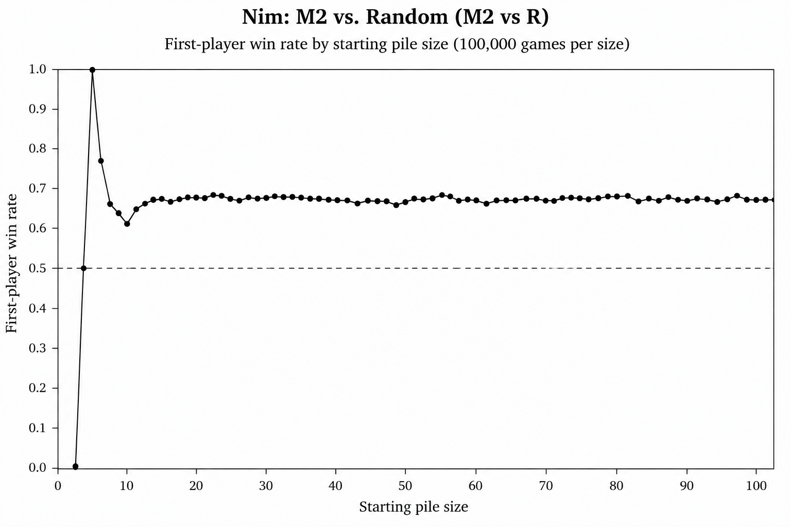
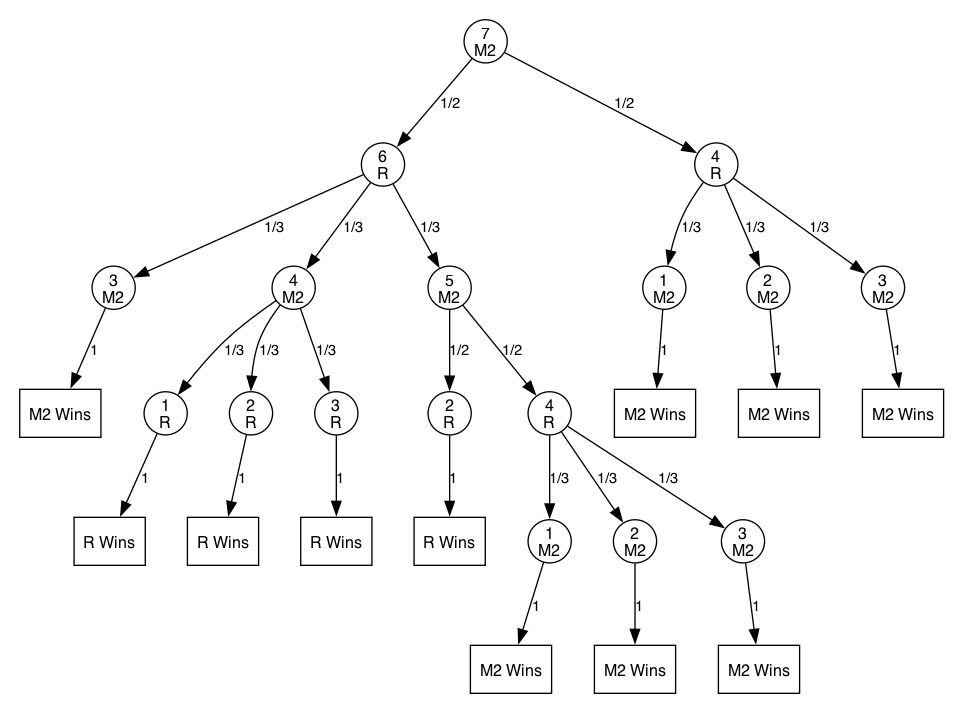

# Abstract

## 1. Introduction
Nim is a simple game of pick up sticks where each player takes turns picking up 1, 2, or 3 sticks, with the goal being to pick up the last stick. While an optimal strategy has been established [1], this paper intends to understand the performance of an incomplete strategy.

### 1.1 Background
Nim has been studied considerably. The foundational work, and where the optimal strategy was first stated, was produced by Bouton in 1901 [1]. Shortly after, in 1907, Wythoff provided an analysis of a variation of Nim involving two piles of sticks [2], which was later generalized to multiple piles by Moore in 1910 [3]. The later work in the 1930s of Sprague [4] and Grundy [5] independently
generalized the connection between Nim and finite impartial games. Other work has been involved in understanding how people [6], [7] and machines [8], [9] learn strategy.

### 1.2 Motivation
In this paper, while we acknowledge there is an optimal strategy, we explore an incomplete strategy. The rationale for this exploration is that players of Nim may discover a sub-optimal strategy that is still better than naive play. The goal is to understand the performance of a sub-optimal strategy. 

The strategy we study surfaced during actual game play. In an object-oriented programming course, students learned about inheritance and polymorphism by implementing strategy agents that could play against each other. Before students began developing agents, they played the physical game. After students played a handful of rounds, we discussed what the observed. One student described the incomplete strategy that is the focus of this paper.

### 1.3 The Approach
The study of the strategies began with simulated game play across piles of sticks that varied in size from 4 to 100. Agents were paired together and played 100,000 games. The win rate of the player who went first is recorded. The data resulted in graphs with noticeable patterns which this paper explains.

### 1.4 The Result
In the end, we observe that an incomplete strategy still has value and its utility depends on the number of sticks in the starting pile.

## 2. The Strategy Models
There were three strategy models involved in this experiment: a random strategy, an incomplete strategy, and the optimal strategy.

### 2.1 Random Strategy (R)
The Random Strategy (R) models a beginner. A beginner doesn't have an explicit strategy, so behaves randomly, but it is endgame-aware. That is, if the pile has 3 or fewer sticks, the strategy says to pick them all up to win. So, R applies the follwing rules:

- If there are 3 or fewer sticks, take them all.
- If there are 4 or more sticks, randomly take 1, 2, or 3.

### 2.2 Optimal Strategy (M4)
The optimal strategy (M4) is to leave the pile with a multiple-of-4 number of sticks [1]. As we will see, once M4 is able to establish such a pile of sticks, it will win. Where things will get interesting is when the pile of sticks is a multiple of 4. When M4 encounters that situation, it resorts to random play. If there are n sticks in the pile, M4's rules are 

- if $n \;(\mathrm{mod}\; 4) = 0 \neq 0$, take $n \;(\mathrm{mod}\; 4) = 0$ sticks
- if $n \;(\mathrm{mod}\; 4) = 0 = 0$, randomly take 1, 2, or 3 sticks

### 2.3 Incomplete Strategy (M2)
The incomplete strategy we study is one that attempts to leave the stick pile with an even number. What makes this strategy interesting is that some of the time the optimal strategy is applied (i.e., some multiples of 2 are also multiples of 4).

This strategy applies the following rules:

- If there are 3 or fewer sticks, take them all.
- If the stick pile has an even number, take 2 sticks.
- If the stick pile has an odd number, randomly take 1 or 3 sticks.

## 3. M2 Performance
What we are after, is an understanding of the effectiveness of the M2 strategy. As it is an incomplete strategy, we will look at the probability of M2 winnging against R and M4 and do so over different size starting piles, from 4-100. For each pile of different sizes, we exectuted 100,000 games.

We begin by examining M2's effectiveness against R. Figure 1 shows the graph. There are some obvious points of interest. Essentially, we are seeing the probability of M2 winning against R given the number of sticks in the starting pile. 

<figure class="numbered">
  
  <figcaption>
    Win rate for M2 against R as a function of the initial pile size.
  </figcaption>
</figure>

### 3.1 The Cases of $n = 4, 5,$ and $6$
For the cases of $n\;=\;4,5$ or $6$, the probabilities are definitive.

Performance of the M-agents.

| n  | Win Rate Going First |
|:--:|:--------------------:|
| 4  | 0.0%                 |
| 5  | 50.0%                |
| 6  | 100.0%               |
{: .numbered-table}

When the game starts with 4 sticks, the second player (assuming they are endgame-aware) will always win. The first player has to remove 1, 2, or 3 sticks which leaves 3, 2, or 1 in the pile. The second player takes them all. So, M2 can't win when going first against R.

For a starting pile size of 5, M2 randomly decides to take 1 or 3 sticks with equal probability. If it takes 1, it leaves the pile in a state of 0 (mod 4), and wins. If it takes 3, the pile will have less than 4 sticks and R will win. This means the probability of M2 winning is 0.5, which we see.

If there are 6 sticks in the pile, M2's rules instruct it to take 2. This leaves a pile of 4 for R to deal with and means M2 will always win.

### 3.2 The Case of $n = 7$
We explicitly analyze the case for $n=7$ be looking at its probability tree, which is shown in Figure 2.

<figure class="numbered">
  
  <figcaption>
    M2 versus R probability tree for $n=7$.
  </figcaption>
</figure>

The probability is calculated in Table 2, where M2W stands for "M2 Wins.

The probability of each winning path for M2.

| Path | Probability |
|:----:|:-----------:|
| 7-6-3-M2W | $\frac{1}{2} \cdot \frac{1}{3} = \frac{1}{6}$|
| 7-6-5-4-1-M2W | $\frac{1}{2} \cdot \frac{1}{3}  \cdot \frac{1}{2} \cdot \frac{1}{3} = \frac{1}{36}$|
| 7-6-5-4-2-M2W | $\frac{1}{2} \cdot \frac{1}{3}  \cdot \frac{1}{2} \cdot \frac{1}{3} = \frac{1}{36}$|
| 7-6-5-4-3-M2W | $\frac{1}{2} \cdot \frac{1}{3}  \cdot \frac{1}{2} \cdot \frac{1}{3} = \frac{1}{36}$|
| 7-4-1-M2W | $\frac{1}{2} \cdot \frac{1}{3} = \frac{1}{6}$|
| 7-4-2-M2W | $\frac{1}{2} \cdot \frac{1}{3} = \frac{1}{6}$|
| 7-4-3-M2W | $\frac{1}{2} \cdot \frac{1}{3} = \frac{1}{6}$|
|**Total:** | **$\frac{3}{4}$** |
{: .numbered-table}

This aligns with the experimental data. Table 3 gives the experimental outcomes for the stick piles of 4 thorugh 10.

Experimental probability M2 wins when going first given a stick piles of size 4 through 10 (100,000 games).

|$n$ | P(M2 wins) |
|----|------------|
|4   |  0.00000   |
|5   |  0.50076   |
|6   |  1.00000   |
|**7**   |  **0.75121** |
|8   |  0.49722   |
|9   |  0.62281   |
|10  |  0.75240   |
{: .numbered-table}

### 3.2 M2 Converges On $\frac{2}{3}$
While we could construct probability trees for any size pile, what we are really after is what happens as the stick piles grow in size. Specifically, looking at Figure 1, it appears that the probability M2 winning against R starts to converge. The experimental data suggests that it is converging on $\frac{2}{3}$. The probabilities computed from experimental data for piles sizes 90 through 100 are given in Table 3, and the explicitly computed probabilities agree.

Experimental probability M2 wins when going first given a stick piles of size 90 through 100 (100,000 games).

|$n$   | Experimental   | Computed         |
|:----:|:--------------:|:----------------:|
|90    |  0.66571       | 0.666666666667   |
|91    |  0.66611       | 0.666666666667   |
|92    |  0.66447       | 0.666666666667   |
|93    |  0.66744       | 0.666666666667   |
|94    |  0.66807       | 0.666666666667   |
|95    |  0.66719       | 0.666666666667   |
|96    |  0.66870       | 0.666666666667   |
|97    |  0.66490       | 0.666666666667   |
|98    |  0.66591       | 0.666666666667   |
|99    |  0.66589       | 0.666666666667   |
|100   |  0.66719       | 0.666666666667   |
{: .numbered-table}

In fact, Table 4 shows the position of the first non-6 in the decimal representation for $n = 100, 1000, 10000,$ and $100000$ and the value of the digit that differs.

| $n$ | first non-6 position | first non-6 digit |
|---:|---:|---:|
| 100 | 15 | 4 |
| 1,000 | 150 | 5 |
| 10,000 | 1,505 | 4 |
| 100,000 | 15,051 | 5 |

We can demonstrate this this mathematically. Define the following:

$$P_n = P(\text{M2 wins } \mid n \text{ sticks, M2 to move})$$

$$Q_n = P(\text{M2 wins } \mid n \text{ sticks, R to move})$$

For $1 \le n \le 6$ we manually compute the probabilities:

$$P_1 = 1, P_2 = 1, P_3 = 1, P_4 = 0, P_5 = \dfrac{1}{2}, P_6 = 1$$

For $1 \le n \le 3$, $P_n$ is 1 since the first player will take all the sticks. The other cases were explained in section 3.1.

For $n \ge 7$, we have the following relationship:

$$
P_n =
\begin{cases}
Q_{n-2}, & n \text{ even}, \\
\dfrac{1}{2}Q_{n-1} + \dfrac{1}{2}Q_{n-3}, & n \text{ odd}.
\end{cases}
$$

and futher

$$Q_n = \dfrac{1}{3}(P_{n-1} + P_{n-2} + P_{n-3})$$

The reason the subscript on $Q$ in the even case is $n-2$ is because M2's rule for an even pile is to take 2 sticks. It will do that 100% of the time. This means the probability of M2 winning with $n$ sticks, when $n$ is even, is the same as the probability of M2 winning when the stick pile is of size $n-2$. For the odd case, M2 will pick either 1 or 3 sticks with equal probability, hence the $\frac{1}{3}$ coefficient and the subscripts $n-1$ and $n-3$.

For $Q_n$, we observe that when it is R's turn, it takes 1, 2, or 3 sticks with equal probability, hence the $\frac{1}{3}$ coefficient and the subscripts $n-1$, $n-2$, and $n-3$.   

Now, substituting in the expansion of $Q_n$ into the piecewise expression, we get the recurrence relation when $n \ge 7$,

$$
P_n =
\begin{cases}
\dfrac{1}{3}(P_{n-3} + P_{n-4} + P_{n-5}), & n \text{ even}, \\
\dfrac{1}{6}(P_{n-2} + P_{n-3} + 2P_{n-4} + P_{n-5} + P_{n-6}), & n \text{ odd}.
\end{cases}
$$

In a nutshell, every new probability is an average of earlier probabilities.

We can now state our first theorem:

**Theorem 3.1.** $\displaystyle \lim_{n \to \infty}P_n = \dfrac{2}{3}$.

Before we can prove Theorem 1, we need to establish a relationship among the probabilites. Consider $P_n$ for $7 \le n \le 16$, shown in Table 4.

Computed probabilities M2 wins when going first given a stick piles of size 7 through 18 (100,000 games).

|  $n$ |      $P_n$       |        Relationship              |
|:----:|:----------------:|:--------------------------------:|
| 7    | $\frac{3}{4}$    | -                                |
| 8    | $\frac{1}{2}$    | -                                |
| 9    | $\frac{5}{8}$    | -                                |
| 10   | $\frac{3}{4}$    | -                                |
| 11   | $\frac{11}{16}$  | $\frac{1}{4} P_7 + \frac{1}{2}$  |
| 12   | $\frac{5}{8}$    | $\frac{1}{4} P_8 + \frac{1}{2}$  |
| 13   | $\frac{21}{32}$  | $\frac{1}{4} P_9 + \frac{1}{2}$  |
| 14   | $\frac{11}{16}$  | $\frac{1}{4} P_{10} + \frac{1}{2}$ |
| 15   | $\frac{43}{64}$  | $\frac{1}{4} P_{11} + \frac{1}{2}$ |
| 16   | $\frac{21}{32}$  | $\frac{1}{4} P_{12} + \frac{1}{2}$ |
| 17   | $\frac{85}{128}$ | $\frac{1}{4} P_{13} + \frac{1}{2}$ |
| 18   | $\frac{43}{64}$  | $\frac{1}{4} P_{14} + \frac{1}{2}$ |
{: .numbered-table}

The pattern does continue and gives rise to Lemma 3.2.

**Lemma 3.2** $P_{n+4} = \frac{1}{4}P_n + \frac{1}{2}$.

**Proof.**

## Scratch Work

For $n \ge 1$, let 

$$P_n = P(\text{M2 wins} \mid n \text{ sticks remain and M2 moves next}).$$

We have the following boundary values, 

$$P_1 = P_2 = P_3 = P6 = 1, \qquad P_4 = 0, \qquad P_5 = \dfrac{1}{2}$$

In the cases $n=1, 2, and 3$, M2 knows to end the game in these situations. When $n=4$, M2 will leave the pile with 1, 2 or 3 sticks and R knows how to end the game. For $n=5$, half the time M2 will take 1 stick, resulting in a win, and half the time it will take 3 sticks, resulting in a loss. Lastly, if $n=6$, M2 will take 2, leaving the pile with 4 sticks and M2's ultimate victory.

We also have the following recurrence relation when $n \ge 7$,

$$
P_n =
\begin{cases}
\dfrac{1}{3}(P_{n-3} + P_{n-4} + P_{n-5}), & n \text{ even}, \\
\dfrac{1}{6}(P_{n-2} + P_{n-3} + 2P_{n-4} + P_{n-5} + P_{n-6}), & n \text{ odd}.
\end{cases}
$$

Ultimately, expanding $P_n$ results in a linear expression in terms of $P_1$ through $P_6$. In fact, they are weighted averages. Thus, we can express $P_n$ as

$$P_n = \sum_{i=1}^{6} w_{n,i}P_i$$

where

$$0 \le w_{n, i} \le 1 \text{  and  } w_{n, 1} + w{n, 2} + ... + w{n_6} = 1$$

This means

$$P_n  = (w_{n,1} + w_{n,2} + w_{n,3} + w_{n,6}) + \dfrac{1}{2}w_{n, 5}$$

Since the weights sum to 1, it must be

$$w_{n,1} + w_{n,2} + w_{n,3} + w_{n,6} = 1 - w_{n,4} + w_{n, 5}$$

Hence, 

$$P_n = 1 - w_{n, 4} - \dfrac{1}{2}w_{n, 5}.$$

Now, let's let $r_n = w_{n, 4}$ (the 'r' for the 'r' in "four") and $v_n = w_{n,5}$ (the 'v' for the 'v' in "five"). This becomes

$$P_n = 1 - r_n -\dfrac{1}{2}v_n.$$

Here are the values for $r_n$ and $v_n$ for $7 \le n \le 28$, 

Computed $r_n$ and $v_n$ for $7 \le n \le 28$

| $n$ |                $r_n$ |                 $v_n$ |
| ----: | ---------------------: | ----------------------: |
|     7 |                $1/6$ |                 $1/6$ |
|     8 |                $1/3$ |                 $1/3$ |
|     9 |               $7/36$ |               $13/36$ |
|    10 |               $1/18$ |                $7/18$ |
|    11 |             $31/216$ |              $73/216$ |
|    12 |             $25/108$ |              $31/108$ |
|    13 |           $235/1296$ |            $421/1296$ |
|    14 |             $85/648$ |             $235/648$ |
|    15 |          $1231/7776$ |           $2641/7776$ |
|    16 |           $721/3888$ |           $1231/3888$ |
|    17 |         $7987/46656$ |         $15373/46656$ |
|    18 |         $3661/23328$ |          $7987/23328$ |
|    19 |       $45991/279936$ |        $93913/279936$ |
|    20 |       $24025/139968$ |        $45991/139968$ |
|    21 |     $281995/1679616$ |      $557941/1679616$ |
|    22 |      $137845/839808$ |       $281995/839808$ |
|    23 |   $1673311/10077696$ |    $3365281/10077696$ |
|    24 |     $846241/5038848$ |     $1673311/5038848$ |
|    25 |  $10096867/60466176$ |   $20136733/60466176$ |
|    26 |   $5019421/30233088$ |   $10096867/30233088$ |
|    27 | $60408151/362797056$ | $120989353/362797056$ |
|    28 | $30291625/181398528$ |  $60408151/181398528$ |

**Conjecture 1.** Let $n \ge 7$ be an odd integer where we express $n$ as $n = 2k + 7$ for some integer $k \ge 0$. Then 

$$v_{2k+8} = 2r_{2k + 7}.$$

**Conjecture 2.** Let $n \ge 8$ be an even integer where we express $n$ as $n = 2k + 8$ for some integer $k \ge 0$. Then 

$$v_{2k+8} = 2r_{2k + 8} + (-1)^{k+1}\dfrac{3^{k+1} - 2^{k+1}}{2^{k}3^{k+1}}.$$

Equating the two expressions from Conjectures 1 and 2, we get, 

$$2r_{2k + 7} = 2r_{2k + 8} + (-1)^{k+1}\dfrac{3^{k+1} - 2^{k+1}}{2^{k}3^{k+1}}.$$

or 

$$r_{2k + 8} - r_{2k + 7} = (-1)^{k}(\dfrac{1}{2^{k+1}} - \dfrac{1}{3^{k+1}}).$$

This gives us

**Conjecture 3.** Let $n \ge 8$ be an even integer where we express $n$ as $n = 2k + 8$ for some integer $k \ge 0$. Then 

$$r_{2k + 8} - r_{2k + 7} = (-1)^{k}(\dfrac{1}{2^{k+1}} - \dfrac{1}{3^{k+1}}).$$

Now, showing any two conjectures will imply the third.

Recall, our original goal was to show the following Lemma:

**Lemma 3.2** $P_{n+4} = \frac{1}{4}P_n + \frac{1}{2}$.

and we have reduced $P_n$ to an expression in terms of $r_n$ and $v_n$,

$$P_n = 1 - r_n - \dfrac{1}{2}v_n.$$

This means we went from dealing with a six weight sqequence, $w_{n,1}$ through $w_{n_6}$ down to just two, $r_n$, and $v_n$. 

If the conjectures are true, we can further eliminate $v_n$. If Conjecture 1 is true, we have 

$$v_n = 2r_{n-1} \qquad \text{ for even } n \ge 8$$

which means

$$P_n = 1 - r_n - r_{n-1} \qquad \text{ for even } n \ge 8.$$

Pulling to all together, we would have 

$$
P_n=
\begin{cases}
1-r_n-r_{n-1}, & n\ge8\text{ even},\\[6pt]
1-r_n-\dfrac12v_n, & n\ge9\text{ odd}.
\end{cases}
$$

If we can eliminate $v_n$ from the odd case, we would then have an expression for $P_n$ in terms of $r_n$ and we may have a way to tackle Lemma 3.2.

## Other Junk

Notice:

$$v_{2k+2} = 2r_{2k+1} \qquad \text{ for } k \in \mathbb{Z} \text{ with } k \ge 0$$

Here are the cases for $3 \le k \le 13$:

| $k$ | $2k+1$ |                   $r_{2k+1}$ |                  $2r_{2k+1}$ |                   $v_{2k+2}$ |
| ----: | -------: | -----------------------------: | -----------------------------: | -----------------------------: |
|     3 |        7 |                $\frac{1}{6}$ |                $\frac{1}{3}$ |                $\frac{1}{3}$ |
|     4 |        9 |               $\frac{7}{36}$ |               $\frac{7}{18}$ |               $\frac{7}{18}$ |
|     5 |       11 |             $\frac{31}{216}$ |             $\frac{31}{108}$ |             $\frac{31}{108}$ |
|     6 |       13 |           $\frac{235}{1296}$ |            $\frac{235}{648}$ |            $\frac{235}{648}$ |
|     7 |       15 |          $\frac{1231}{7776}$ |          $\frac{1231}{3888}$ |          $\frac{1231}{3888}$ |
|     8 |       17 |         $\frac{7987}{46656}$ |         $\frac{7987}{23328}$ |         $\frac{7987}{23328}$ |
|     9 |       19 |       $\frac{45991}{279936}$ |       $\frac{45991}{139968}$ |       $\frac{45991}{139968}$ |
|    10 |       21 |     $\frac{281995}{1679616}$ |      $\frac{281995}{839808}$ |      $\frac{281995}{839808}$ |
|    11 |       23 |   $\frac{1673311}{10077696}$ |    $\frac{1673311}{5038848}$ |    $\frac{1673311}{5038848}$ |
|    12 |       25 |  $\frac{10096867}{60466176}$ |  $\frac{10096867}{30233088}$ |  $\frac{10096867}{30233088}$ |
|    13 |       27 | $\frac{60408151}{362797056}$ | $\frac{60408151}{181398528}$ | $\frac{60408151}{181398528}$ |

**Lemma 2.** For every odd integer $n \ge 7$, 

$$ v_{n+1} = 2r_n.$$

Now, for the case of $n$ even, at the values for $v_n - 2r_n$, where $n=8 + 2k$,

| $n$   | $k$   |          $v_n-2r_n$ |           Denominator |     Numerator construction |
| ----: | ----: | --------------------: | --------------------: | -------------------------: |
|     8 |     0 |              $-1/3$ |                 $3$ |                      $1$ |
|    10 |     1 |              $5/18$ |         $2\cdot3^2$ |               $3(1)+2=5$ |
|    12 |     2 |           $-19/108$ |       $2^2\cdot3^3$ |            $3(5)+2^2=19$ |
|    14 |     3 |            $65/648$ |       $2^3\cdot3^4$ |           $3(19)+2^3=65$ |
|    16 |     4 |         $-211/3888$ |       $2^4\cdot3^5$ |          $3(65)+2^4=211$ |
|    18 |     5 |         $665/23328$ |       $2^5\cdot3^6$ |         $3(211)+2^5=665$ |
|    20 |     6 |      $-2059/139968$ |       $2^6\cdot3^7$ |        $3(665)+2^6=2059$ |
|    22 |     7 |       $6305/839808$ |       $2^7\cdot3^8$ |       $3(2059)+2^7=6305$ |
|    24 |     8 |    $-19171/5038848$ |       $2^8\cdot3^9$ |      $3(6305)+2^8=19171$ |
|    26 |     9 |    $58025/30233088$ |    $2^9\cdot3^{10}$ |     $3(19171)+2^9=58025$ |
|    28 |    10 | $-175099/181398528$ | $2^{10}\cdot3^{11}$ | $3(58025)+2^{10}=175099$ |

In fact, if we let

$$A_k = (-1)^{k+1}(3 A_{k-1} + 2^k) \qquad k \ge 0$$

then we have 

$$v_{8+2k} - 2r_{8 + 2k} = \dfrac{A_k}{2^k3^{k+1}} \qquad k \ge 0$$

which, expanded, is

$$v_{8+2k} - 2r_{8 + 2k} = (-1)^{k+1}\dfrac{3^{k+1} - 2^{k+1}}{2^k3^{k+1}} \qquad k \ge 0$$

and equivalent to 

$$v_{8+2k} - 2r_{8 + 2k} = (-1)^{k+1}(\dfrac{1}{2^k} - \dfrac{2}{3^{k+1}}) \qquad k \ge 0$$

But we could also state it as

**Lemma 3.** Let $n \in \mathbb{Z}$ with $n \ge 8$. Define $k$ as

$$k = \dfrac{n-8}{2}.$$

Then

$$v_n = 2r_n + (-1)^{k+1}(\dfrac{1}{2^k} - \dfrac{2}{3^{k+1}}).$$

-------

With Lemma 3.2, the proof of Theorm 3.1 is rather straightforward.

**Proof of Theorem 3.1.** An equivalent expression to Lemma 3.2 is the following

$$P_{n+4} = \frac{2}{3} + \frac{1}{4}(P_{n} - \frac{2}{3})$$

If we let $r \in {4, 5, 6, 7}$, and express $n = r + 4k$, we get four sets of relations,

$$P_{r+4k} = \frac{2}{3} + (\frac{1}{4})^k(P_{r} - \frac{2}{3})$$

This means,  

$$\lim_{n \to \infty}P_n = \frac{2}{3}$$ 

is true since 

$$\lim_{k \to \infty}P_{r + 4k} = P_{r+4k} = \frac{2}{3} + (\frac{1}{4})^k(P_{r} - \frac{2}{3}) = \frac{2}{3}$$ 

for each $r$ where $r \in {4, 5, 6, 7}$ is true. **QED**

## 4. M4 Performance

|    | P_6 | P_5 | P_4 | P_3 | P_2 | P_1 |
|----|-----------------|---------------|---------------|---------------|----------------|---------------|
|P_7 |  $0$            | $\frac{1}{6}$ | $\frac{1}{6}$ | $\frac{2}{6}$ |  $\frac{1}{6}$ | $\frac{1}{6}$ |
|P_8 |  $0$            | $\frac{1}{3}$ | $\frac{1}{3}$ | $\frac{2}{3}$ |  0             | 0             |
|P_9 |  $\frac{1}{6}$  | $\frac{13}{6^2}$ | $\frac{7}{6^2}$ | $\frac{8}{6^2}$ |  $\frac{1}{6^2}$ | $\frac{1}{6^2}$ |
|P_10|  $\frac{1}{3}$  | $\frac{7}{3 \cdot 6}$ | $\frac{1}{3 \cdot 6}$ | $\frac{2}{3 \cdot 6}$ |  $\frac{1}{3 \cdot 6}$ | $\frac{1}{3 \cdot 6}$ |
|P_11|  $\frac{7}{6^2}$ | $\frac{73}{6^3}$ | $\frac{31}{6^3}$ | $\frac{44}{6^3}$ |  $\frac{13}{6^3}$ | $\frac{13}{6^3}$ |
|P_12|  $\frac{1}{3 \cdot 6}$ | $\frac{31}{3 \cdot 6^2}$ | $\frac{25}{3 \cdot 6^2}$ | $\frac{32}{3 \cdot 6^2}$ |  $\frac{7}{3 \cdot 6^2}$ | $\frac{7}{3 \cdot 6^2}$ |
|P_13|  $\frac{31}{6^3}$ | $\frac{1263}{3 \cdot 6^4}$ | $\frac{705}{3 \cdot 6^4}$ | $\frac{924}{3 \cdot 6^4}$ |  $\frac{219}{3 \cdot 6^4}$ | $\frac{219}{3 \cdot 6^4}$ |

## 5. Introduce and Explain M3

|  | $P_6$ | $P_5$ | $P_4$ | $P_3$ | $P_2$ | $P_1$ |
|:--|:--:|:--:|:--:|:--:|:--:|:--:|
| $P_7$ | $0$ | $1/6$ | $1/6$ | $1/3$ | $1/6$ | $1/6$ |
| $P_8$ | $0$ | $1/3$ | $1/3$ | $1/3$ | $0$ | $0$ |
| $P_9$ | $1/6$ | $13/36$ | $7/36$ | $2/9$ | $1/36$ | $1/36$ |
| $P_{10}$ | $1/3$ | $7/18$ | $1/18$ | $1/9$ | $1/18$ | $1/18$ |
| $P_{11}$ | $7/36$ | $73/216$ | $31/216$ | $11/54$ | $13/216$ | $13/216$ |
| $P_{12}$ | $1/18$ | $31/108$ | $25/108$ | $8/27$ | $7/108$ | $7/108$ |
| $P_{13}$ | $31/216$ | $421/1296$ | $235/1296$ | $77/324$ | $73/1296$ | $73/1296$ |
| $P_{14}$ | $25/108$ | $235/648$ | $85/648$ | $29/162$ | $31/648$ | $31/648$ |
| $P_{15}$ | $235/1296$ | $2641/7776$ | $1231/7776$ | $413/1944$ | $421/7776$ | $421/7776$ |
| $P_{16}$ | $85/648$ | $1231/3888$ | $721/3888$ | $239/972$ | $235/3888$ | $235/3888$ |
| $P_{17}$ | $1231/7776$ | $15373/46656$ | $7987/46656$ | $2657/11664$ | $2641/46656$ | $2641/46656$ |
| $P_{18}$ | $721/3888$ | $7987/23328$ | $3661/23328$ | $1223/5832$ | $1231/23328$ | $1231/23328$ |
| $P_{19}$ | $7987/46656$ | $93913/279936$ | $45991/279936$ | $15341/69984$ | $15373/279936$ | $15373/279936$ |
| $P_{20}$ | $3661/23328$ | $45991/139968$ | $24025/139968$ | $8003/34992$ | $7987/139968$ | $7987/139968$ |
| $P_{21}$ | $45991/279936$ | $557941/1679616$ | $281995/1679616$ | $93977/419904$ | $93913/1679616$ | $93913/1679616$ |

|  | $P_6$ | $P_5$ | $P_4$ | $P_3$ | $P_2$ | $P_1$ |
|:--|:--:|:--:|:--:|:--:|:--:|:--:|
| $P_7$ | $0$ | $\frac{1}{2\cdot3}$ | $\frac{1}{2\cdot3}$ | $\frac{1}{3}$ | $\frac{1}{2\cdot3}$ | $\frac{1}{2\cdot3}$ |
| $P_8$ | $0$ | $\frac{1}{3}$ | $\frac{1}{3}$ | $\frac{1}{3}$ | $0$ | $0$ |
| $P_9$ | $\frac{1}{2\cdot3}$ | $\frac{1+12}{2^2 3^2}$ | $\frac{1+6}{2^2 3^2}$ | $\frac{1+3}{2^2 3^2}$ | $\frac{1}{2^2 3^2}$ | $\frac{1}{2^2 3^2}$ |
| $P_{10}$ | $\frac{1}{3}$ | $\frac{1+6}{2 \cdot 3^2}$ | $\frac{1}{2  \cdot  3^2}$ | $\frac{1}{2 \cdot  3^2}$ | $\frac{1}{2  \cdot 3^2}$ | $\frac{1}{2  \cdot 3^2}$ |
| $P_{11}$ | $\frac{1+6}{2^2 3^2}$ | $\frac{13+12+12+36}{2^3 3^3}$ | $\frac{7+12+12}{2^3 3^3}$ | $\frac{2+3+6}{2^3 3^3}$ | $\frac{1+12}{2^3 3^3}$ | $\frac{1+12}{2^3 3^3}$ |
| $P_{12}$ | $\frac{1}{2\cdot3^2}$ | $\frac{13+12+6}{2^2 3^3}$ | $\frac{7+12+6}{2^2 3^3}$ | $\frac{2+3+3}{2^2 3^3}$ | $\frac{1+6}{2^2 3^3}$ | $\frac{1+6}{2^2 3^3}$ |
| $P_{13}$ | $\frac{7+12+12}{2^3 3^3}$ | $\frac{73+84+156+72+36}{2^4 3^4}$ | $\frac{31+12+84+72+36}{2^4 3^4}$ | $\frac{11+6+24+18+18}{2^2 3^4}$ | $\frac{13+12+12+36}{2^4 3^4}$ | $\frac{13+12+12+36}{2^4 3^4}$ |
| $P_{14}$ | $\frac{7+12+6}{2^2 3^3}$ | $\frac{73+84+78}{2^3 3^4}$ | $\frac{31+12+42}{2^3 3^4}$ | $\frac{11+6+12}{2 3^4}$ | $\frac{13+12+6}{2^3 3^4}$ | same |
| $P_{15}$ | $\frac{31+12+84+72+36}{2^4 3^4}$ | $\frac{421+372+876+504+468}{2^5 3^5}$ | $\frac{235+300+372+72+252}{2^5 3^5}$ | $\frac{77+96+132+36+72}{2^3 3^5}$ | $\frac{73+84+156+72+36}{2^5 3^5}$ | same |
| $P_{16}$ | $\frac{31+12+42}{2^3 3^4}$ | $\frac{421+372+438}{2^4 3^5}$ | $\frac{235+300+186}{2^4 3^5}$ | $\frac{77+96+66}{2^2 3^5}$ | $\frac{73+84+78}{2^4 3^5}$ | same |
| $P_{17}$ | $\frac{235+300+372+72+252}{2^5 3^5}$ | $\frac{2641+2820+5052+2232+2628}{2^6 3^6}$ | $\frac{1231+1020+2820+1800+1116}{2^6 3^6}$ | $\frac{413+348+924+576+396}{2^4 3^6}$ | $\frac{421+372+876+504+468}{2^6 3^6}$ | same |
| $P_{18}$ | $\frac{235+300+186}{2^4 3^5}$ | $\frac{2641+2820+2526}{2^5 3^6}$ | $\frac{1231+1020+1410}{2^5 3^6}$ | $\frac{413+348+462}{2^3 3^6}$ | $\frac{421+372+438}{2^5 3^6}$ | same |
| $P_{19}$ | $\frac{1231+1020+2820+1800+1116}{2^6 3^6}$ | $\frac{15373+14772+31692+16920+15156}{2^7 3^7}$ | $\frac{7987+8652+14772+6120+8460}{2^7 3^7}$ | $\frac{2657+2868+4956+2088+2772}{2^5 3^7}$ | $\frac{2641+2820+5052+2232+2628}{2^7 3^7}$ | same |
| $P_{20}$ | $\frac{1231+1020+1410}{2^5 3^6}$ | $\frac{15373+14772+15846}{2^6 3^7}$ | $\frac{7987+8652+7386}{2^6 3^7}$ | $\frac{2657+2868+2478}{2^4 3^7}$ | $\frac{2641+2820+2526}{2^6 3^7}$ | same |
| $P_{21}$ | $\frac{7987+8652+14772+6120+8460}{2^7 3^7}$ | $\frac{93913+95844+184476+88632+95076}{2^8 3^8}$ | $\frac{45991+43932+95844+51912+44316}{2^8 3^8}$ | $\frac{15341+14676+31884+17208+14868}{2^6 3^8}$ | $\frac{15373+14772+31692+16920+15156}{2^8 3^8}$ | same |

## Making a Mess

| $n$ |                       $r_n$                       |                         $v_n$                         |
| ----: | :-----------------------------------------------------: | :---------------------------------------------------------: |
|     7 |                  $\frac{1}{2\cdot3}$                  |                    $\frac{1}{2\cdot3}$                    |
|     8 |                     $\frac{1}{3}$                     |                       $\frac{1}{3}$                       |
|     9 |              $\frac{1+6\;(=7)}{2^2 3^2}$              |               $\frac{1+12\;(=13)}{2^2 3^2}$               |
|    10 |                 $\frac{1}{2\cdot3^2}$                 |               $\frac{1+6\;(=7)}{2\cdot3^2}$               |
|    11 |            $\frac{7+12+12\;(=31)}{2^3 3^3}$           |            $\frac{13+12+12+36\;(=73)}{2^3 3^3}$           |
|    12 |            $\frac{7+12+6\;(=25)}{2^2 3^3}$            |              $\frac{13+12+6\;(=31)}{2^2 3^3}$             |
|    13 |        $\frac{31+12+84+72+36\;(=235)}{2^4 3^4}$       |         $\frac{73+84+156+72+36\;(=421)}{2^4 3^4}$         |
|    14 |           $\frac{31+12+42\;(=85)}{2^3 3^4}$           |             $\frac{73+84+78\;(=235)}{2^3 3^4}$            |
|    15 |     $\frac{235+300+372+72+252\;(=1231)}{2^5 3^5}$     |       $\frac{421+372+876+504+468\;(=2641)}{2^5 3^5}$      |
|    16 |         $\frac{235+300+186\;(=721)}{2^4 3^5}$         |           $\frac{421+372+438\;(=1231)}{2^4 3^5}$          |
|    17 |  $\frac{1231+1020+2820+1800+1116\;(=7987)}{2^6 3^6}$  |    $\frac{2641+2820+5052+2232+2628\;(=15373)}{2^6 3^6}$   |
|    18 |       $\frac{1231+1020+1410\;(=3661)}{2^5 3^6}$       |         $\frac{2641+2820+2526\;(=7987)}{2^5 3^6}$         |
|    19 | $\frac{7987+8652+14772+6120+8460\;(=45991)}{2^7 3^7}$ | $\frac{15373+14772+31692+16920+15156\;(=93913)}{2^7 3^7}$ |
|    20 |       $\frac{7987+8652+7386\;(=24025)}{2^6 3^7}$      |       $\frac{15373+14772+15846\;(=45991)}{2^6 3^7}$       |

## 6. Future Work
Add stuff about perception
Add stuff about augmenting M4 algorithm to have a better mod 4 = 0 
Add stuff about picking up 1-k sticks

## 8. Conclusion

Let

$$P_1 = 1, P_2 = 1, P_3 = 1, P_4 = 0, P_5 = \dfrac{1}{2}, P_6 = 1$$

Then for $n \ge 7$, define:

$$
P_n =
\begin{cases}
\dfrac{1}{3}(P_{n-3} + P_{n-4} + P_{n-5}), & n \text{ even}, \\
\dfrac{1}{6}(P_{n-2} + P_{n-3} + 2P_{n-4} + P_{n-5} + P_{n-6}), & n \text{ odd}.
\end{cases}
$$

We can now state our first theorem:

**Theorem 3.1.** $\displaystyle \lim_{n \to \infty}P_n = \dfrac{2}{3}$.

which is easy if we can establish

**Lemma 3.2** $P_{n+4} = \frac{1}{4}P_n + \frac{1}{2}$, for $n \ge 7$.

## 9. References
1. C. L. Bouton, "Nim, a Game with a Complete Mathematical Theory" *Annals of Mathematics*, 3(1/4), 1901, pp. 35–39.

2. Wythoff, W. A. (1907). "A Modification of the Game of Nim."
  *Nieuw Archief voor Wiskunde*, 8, 199–202.

3. Moore, E. H. (1910). "A Generalization of the Game Called Nim."
  *Annals of Mathematics*, 11(3), 93–94.
  https://doi.org/10.2307/1967321

4. Sprague, R. P. (1935). "Über mathematische Kampfspiele."
  *Tôhoku Mathematical Journal*, 41, 438–444.

5. Grundy, P. M. (1939). "Mathematics and Games."
  *Eureka*, 2, 6–8.

6. McKinney, C. N., Jr., & Van Huyck, J. B. (2013).
  "Eureka Learning: Heuristics and Response Time in Perfect
  Information Games." *Games and Economic Behavior*, 79, 223–232.
  https://doi.org/10.1016/j.geb.2013.02.003

7. McKinney, C. N., Jr., & Van Huyck, J. B. (2021).
  "Does Playing Against an Error Prone Opponent Influence
  Learning in Nim?" *Journal of Behavioral and Experimental
  Economics*, 95.

8. Oltean, M. (2021).
  "Evolving Winning Strategies for Nim-like Games."
  arXiv:2109.13109.

9. Zhou, B., & Riis, S. (2026).
  "Impartial Games: A Challenge for Reinforcement Learning."
  *Machine Learning*, 115(3).
  https://doi.org/10.1007/s10994-026-06996-1       
