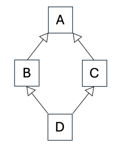

In C++, it is possible for a class to inherit from multiple base classes. This is called multiple inheritance. There are two forms of inheritance:

**Implementation inheritance**. This is when a class inherits from a base classes with attributes and/or non-pure virtual operations. When a class has no pure virtual operations we call it *concrete*. When a class has at least one pure virtual operations and either attributes or non-pure virtual operations, we call the class *abstract*.

**Interface inheritance.** This when a class inherits from a base class with only pure virtual operations. While still technically abstract, in this special case we will call the class an *interface*.

This gives rise to two key situations: *multiple implementation inheritance*, where a class derives from more then one concrete or abstract class, and *multiple implementation inheritance*, where a class derives only from interfaces.

**TL;DR** - *Avoid multiple implementation inheritance. Multiple interface inheritance is common and natural.*

It is worth nothing that a class can derive from both concrete/abstract classes and interfaces. While we argue against multiple implementation inheritance, it is reasonable to be subclass of a single concrete/abstract class and multiple interfaces. That is a natural extension of this discussion, but one we do not engage.


## Multiple Implementation Inheritance
The issue with multiple implementation inheritance is two-fold and it comes down to ambiguity. Let’s start with the easier situation: a class derives from two unrelated base classes. Consider the following:

```cpp
class X {
public:

    virtual ~X() {};

    virtual void print() { std::cout << "X" << std::endl; }

};


class Y {
public:

    virtual ~Y() {};

    virtual void print() { std::cout << "Y" << std::endl; }

};


class Z : public X, public Y {};
```

Here, `Z` inherits two versions of `print()`. This means given

```cpp
Z z;
z.print();
```

the call `z.print()` is ambiguous. This isn’t unresolvable. If we want to invoke `print()` on `z`, we can simply resolve the call. For example, if we want to invoke X::print(), it's simply

```cpp
z.X::print()
```

It also works with pointers,

```cpp
z->X::print();
```

In both cases, we have static binding. That is, we are explicitly invoking `X`‘s `print()`. In general, while we can invoke base class behavior in the presence of polymorphism, it is generally not what we want.

We have a similar situation when the two base classes share a common attribute. For example,

```cpp
class X {
protected:
    
    int i;

public:

    virtual ~X() {};

    virtual void getI() { return i; }

};


class Y {
protected:

    int i;

public:

    virtual ~Y() {};

    virtual void getI() { return i; }

};


class Z : public X, public Y {
public:

    virtual void setI(int newI) { 

        // This won’t compile. Which i?
        i = newI; 

     }

};
```

In this example, perhaps we could easily resolve it by ensuring both of the `i`‘s are updated,

```cpp
void setI(int newI) {
    X::i = newI;
    Y::i = newI;
}
```

And while we still have the issue of the conflicting `getI()` implementations, in this context we could implement a version of `getI()` for `Z` as

```cpp
class Z : public X, public Y {
public:

    virtual void setI(int newI) { 

        // This won’t compile. Which i?
        //
        i = newI; 

    }

    virtual int getI() {

        // Since in set we maintain both together, we can return 
        // either.
        //
        return X::i;   // or return Y::i;

    }
};
```

### Example: Package Model
Let's consider a more practical example. We start with a base class, `Package`, with two sublcasses, `InsuredPackage` and `Tracked Package`,

```cpp
class Package {
private:

    constexpr static double SHIPPING_RATE_PER_POUND = 0.50;

    static int nextId;

    int id;
    double weightInPounds;
    string zipCode;

public:

    Package(double initWeightInPounds, string initZipCode)
        : id(nextId++), 
          weightInPounds(initWeightInPounds), 
          zipCode(initZipCode) {

    }


    int getId() const {
        return id;
    }

    double getWeight() const {
        return weight;
    }


    string getZipCode() const {
        return zipCode;
    }

    virtual double getShippingCost() const {
        return weight * SHIPPING_RATE_PER_POUND;
    }

};

class InsuredPackage : public Package {
private:

    constexpr static double INSURANCE_RATE = 0.10;

    double insuredValue;

public:

    InsuredPackage(double initWeightInPounds, string initZipCode, double initInsuredValue)
        : Package(initWeightInPounds, initZipCode), 
        insuredValue(initInsuredValue) {

    }

    double getInsuredValue() const {
        return insuredValue;
    }

    double getShippingCost() const {
        return Package::getShippingCost() + insuredValue * INSURANCE_RATE;
    }

};


enum Status {WAREHOUSE, TRANIST, DELIVERED};

class TrackedPackage : public Package {
private:

    constexpr static double TRACKING_FEE = 15.00;

    Status status;

public:

    TrackedPackage(double initWeightInPounds, string initZipCode, Status initStatus) 
        : Package(initWeightInPounds, initZipCode), 
          status(initStatus) {

    }

    Status getStatus() const {
        return status;
    }

    void updateStats(Status newStatus) {
        status = newStatus;
    }

    double getShippingCost() const {
        return Package::getShippingCost() + TRACKING_FEE;
    }

};
```

So far so good. However, we run into a problem when we try to use multiple inheritance to model the obvious class, `InsuredTrackedPacakage`, 

```cpp
class InsuredTrackedPackage : public InsuredPackage, TrackedPackage {
public:

    double getShippingCost() const {
        // ????
    }

};
```

The challenge is in implementing `getShippingCost()`. Initially, we might try

```cpp
double InsuredTrackedPackage::getShippingCost() const {
    return InsuredPackage::getShippingCost() + TrackedPacakage::getShippingCost();
}
```

but that results in two calls to `Package::getShippingCost()` and we are double charging the base cost to ship a package. 

Hopefully it is obvious that we could solve this by redesigning the classes. The point is that multiple implementation inheritance doesn't come without overhead.

Ideally, it's best to avoid multiple inheritance as it isn't a necessity. Consider Java: It doesn’t permit implementation inheritance and both C++ and Java are general-purpose, Turing-complete programming languages. There is no computational behavior realizable in C++ that is fundamentally unrealizable in Java. A language feature available in C++ but absent from Java may make a particular object-oriented design impossible to reproduce directly in Java. This does not, however, establish that the behavior provided by that design cannot be realized by a different Java design.


## Virtual Inheritance
A common problem with multiple inheritance is the *Diamond Problem*: a class inherits from two base classes that both in turn inherit from a common base class. For example,

```cpp
class A {
private:
    int i;
public:
    virtual int getI() { return i; }
};

class B : public A {};

class C : public A {};

class D : public B, public C {};
```

The corresponding hierarchy forms a diamond as shown in Figure 1.

<figure class="numbered">
  
  <figcaption>
    A UML diagram showing the diamond formed by class A, B, C, and D.
  </figcaption>
</figure>

As with the previous example involving classes `X`, `Y`, and `Z`, using `D` can lead to ambiguity. Specifically, given

```cpp
D d;

d.getI();
```

the call to `getI()` is ambiguous as `D` inherits a version through both `B` and `C` (it also has two copies of `i`). Here, the problem is that the same base class is being inherited twice. To solve this problem, we use virtual inheritance. This is simply a matter of specifying the inheritance in `B` and `C` as virtual:

```cpp
class B : public virtual A {};

class C : public virtual A {};
```

Now, when `D` inherits from both `B` and `C`, only one copy of `A` is included in the structure. This eliminates the ambiguity.

This is a specialized situation that is easily avoided by not using multiple implementation inheritance.


## Multiple Interface Inheritance
The problem with multiple implementation inheritance is there is defined underlying behavior or implementation constraints on defined attributes. When dealing with interfaces (classes that have no attributes and only pure virtual operations), this problem is simplified: since multiple base classes don’t have underlying code, and concrete subclasses must implement pure virtual operations, there is only one method to be concerned about.

Suppose we have two a few interfaces: `Character`, `Wizard`, and `Thief`,

```cpp
class Character {
public:

    virtual ~Character() {}

    virtual void takeDamage() = 0;
    virtual void heal() = 0;

    virtual void equip(Weapon *weapon) = 0;

    virtual int useWeapon() = 0;

};

class Wizard : public Character {
public:

    virtual ~Wizard() {}

    virtual int castSpell(Spell &spell) = 0;

};

class Thief : public Character {
public:

    virtual ~Theif() {}

    virtual void goStealthy() = 0;

};
```

The key here is that every operation means the same thing in every class. So, every `Character` includes

- `takeDamage()` : reduce the health of the character
- `heal()` : increase the health of the character
- `equip(Weapon *weapon)` : set the current weapon of the character
- `weildWeapon()` : use the weapon and get associated damage

whereas `Wizard` adds

- `castSpell(Spell &spell)` : inflicts some damage based on the spell

and `Thief` defines

- `goStealthy()` : improves attack by adding stealth

With these interfaces in place, we can created a hybrid character, `StealthMage`,

```cpp
class StealthMage : public Wizard, public Thief {

    virtual ~Character() {
        // implements
    }

    virtual void takeDamage() { 
        // implements
    }

    virtual void heal() { 
        // implements
    }

    virtual void equip(Weapon *weapon) { 
        // implements
    }

    virtual int useWeapon() { 
        // implements
    }

    virtual int castSpell(Spell &spell) { 
        // implements  
    }

    virtual void goStealthy(Spell &spell) { 
        // implements  
    }

};
```

Since there are no conflicts, we can faithfully implement all operations.

### Functional Conflicts
What we have discussed so far are techincal consflicts. In the last example, we could still have problems from a functional standpoint - e.g., if `takeDamage()` was defined to be significantly different between the two classes.

Suppose we have the following interfaces, 

```cpp
class Reconnectable {
public:

    // Uses an existing connection to reestablish itself.
    //    
    virtual int connect() = 0;

};

class Device {
public:
 
    // Establishes a new connection.
    //
    virtual void connect() = 0;   

}
```

If we wanted to created a `ReconnectableDevice`, we would start with

```cpp
class ReconnectableDevice : public Device, public Reconnectable {
private:
   
    // Stuff to manage the connection

public:

    virtual void connect() {
    
        // ?????
    
    }

};
```

The problem is we can’t faithfully reconnect to the same connection and establish a new connection at the same time.


