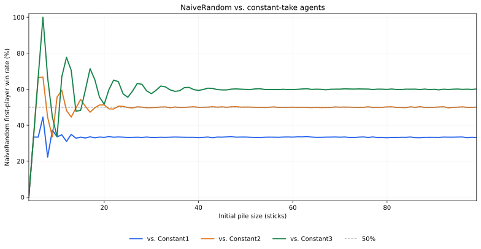
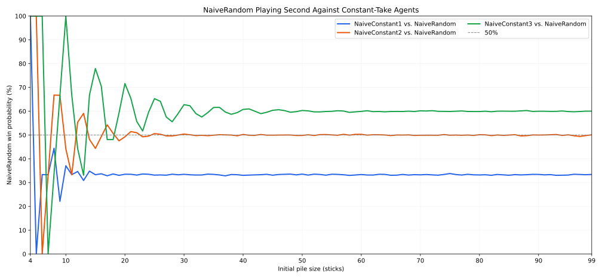

Nim is rather simple game. A pile of sticks is placed between two players. They take turns taking 1, 2, or 3 sticks. The player to pick up the last stick wins. Other versions of the game exist involving multiple piles or playing such that the person to pick up the last stick loses.

First, you may have noticed we didn't say anything about the number of sticks in the initial pile. That can be any positive numnber. As we will see, the probability of winning depends on the number of sticks to start. Thus, we will discuss results of agents playing games with piles varying between 4 and 99 sticks. 

The cases where the starting number of sticks is less than 4 are well understood: Since all agents are endgame aware, if there are less than 4 sticks, the first agent to play will take all the sticks and win.

## Playing Naively
We begin with the simplest of agents: NaiveRandom. The agent plays by the following rule:

```
if 3 or fewer sticks remain
   take them all
else 
   randomly take 1, 2, or 3
```

For the first experiment, we let NaiveRandom play against itself. The results are shown in Figure 1. 

<figure class="numbered">
  
  <figcaption>
    Win rate for NaiveRandom against NaiveRandom as a function of the initial pile size.
  </figcaption>
</figure>

Already, we see the impact of the starting number of sticks.

## A First Strategy
A natural next step a new player might attempt is simply taking a set number of sticks until the endgame. The agent that always takes *N* sticks is called, NaiveContsant*N*. For example, NaiveConstant1 uses the following rule

```
if 3 or fewer sticks remain
   take them all
else 
   take 1
```

Figure 2 shows the probability of NaiveRandom, going first, winning against each of the NaiveConstant*N*s. 

<figure class="numbered">
  
  <figcaption>
    Win rate for NaiveRandom against NativeConstantN when going first.
  </figcaption>
</figure>

Since seating order can affect the outcome of games, we also need to inspect the games where NaiveRandom goes second. Figure 3 shows the probability of NaiveRandom winning against NaiveConstant*N* when going second.

<figure class="numbered">
  
  <figcaption>
    Win rate for NaiveRandom against NativeConstantN when going second.
  </figcaption>
</figure>

Of course, we should also see how each NaiveConstant*N* agent performs against itself and the other NaiveConstant*N* agents. Figure 4 provides interactive graphs illustrating the match ups (hover over the labels to isolate graphs).

<figure id="fig-constant-strategies" class="numbered">
  <iframe
    src="{{ 'nim_constants_interactive.html' }}"
    width="100%"
    height="1460"
    style="border: none;"
    title="Nim Constant Strategy Comparisons">
  </iframe>

  <figcaption>
    First-player win probabilities for the three constant
    strategies against one another, for initial pile sizes
    4 through 99.
  </figcaption>
</figure>

## Pile Residues
The next step involves considering the state of the pile that is left for the opponent. Since we are taking 1-3 sticks, this will leave the piles in residues mod 4. This brings us to our first Enthusiasts: EnthusiastResidue*N* will make choices to leave the stick pile with residue mod 4. Thus, we have EnthusiastResidue0 (eR0), EnthusiastResidue1 (eR1), EnthusiastsResidue2 (eR2), and EnthusiastResidue3 (eR3). When multiple moves are available, the choice is random.

<figure id="fig-constant-strategies" class="numbered">
  <iframe
    src="{{ 'nim_tournament_explorer.html' }}"
    width="100%"
    height="1650"
    style="border: none;"
    title="Exploring the Nim Strategy Tournament">
  </iframe>

  <figcaption>
    Interactive results from a tournament of eight Nim-playing agents over initial pile sizes of 4–99. Each cell in the heat map represents the first player's win percentage against the second player, with color indicating the degree of advantage or disadvantage. Select a cell to examine the results by initial pile size, or adjust the pile-size range to investigate how the relative performance of strategies changes. Diagonal cells are omitted because self-play results were not included in the tournament data.
  </figcaption>
</figure>

Clearly, something stands out: leaving your opponent a pile containing a multiple of 4 sticks is a strong strategy. If you are familiar with Nim, you likely knew that. But the interesting thing we see here is that while it is an optimal strategy, it is not infallible. That is where things get interesting. Also, notice NaiveConstant1 performs reasonably well, too. Simplicity is not necessarily a weakness.

Before exploring that apparent contradiction, we should explain why leaving your opponent a multiple of 4 sticks is optimal. Recall that a player may remove 1, 2, or 3 sticks on each turn, and the player who takes the last stick wins. If you leave your opponent a multiple of 4, they must remove 1, 2, or 3 sticks. You can then remove 3, 2, or 1 sticks, respectively, so that the two moves together remove exactly 4 sticks. This returns your opponent to another multiple of 4. By repeating this process, you eventually leave your opponent with 4 sticks. Whatever they remove, you can take the remaining sticks and win. Of course, this strategy requires that you first have an opportunity to leave a multiple of 4. If you begin with a multiple of 4 yourself, a sufficiently clever opponent can use the same strategy against you.

## Piles of Other Multiples
What we observed is leaving your opponent a pile that is a multiple of 4 is advantageous. We will rename EnthusiastResidue0 to M4: attempt to leave the pile in a multiple of 4. M4's decision structure is

```
if sticksRemaining % 4 == 0
  randomly take 1, 2, or 3
else
  take sticksRemaining % 4 sticks
```

Notice that M4 is endgame aware. 

What about leaving the piles in multiples of other numbers? Define M*n* to be an agent that attempts to leave the pile in a multiple of *n*. M*n*'s decision is made in the following way

```
if 3 or fewer sticks remain
  take all the sticks
else 
  determine all moves that leave the pile in a multiple of n
  if the list is not empty
    choose a move randomly
  else
    randomly take 1, 2, or 3 sticks
```

We will consider two new agents: M2 and M3. We do not consider M*n* for *n* > 4. The reason has to do with the number of sticks a player can remove. To leave an opponent a multiple of *n*, a player must remove a number of sticks equal to the current pile's remainder modulo *n*. Since the legal moves are 1, 2, and 3, this is always possible for nonzero remainders when *n* is at most 4. But consider M5. If a pile contains 9 sticks, we would need to remove 4 sticks to leave a multiple of 5, which the rules prohibit. More generally, for any *n*>4, some nonzero remainders cannot be eliminated in a single move. Thus, M4 is the largest member of this family that can always reach its desired multiple from a pile that is not already a multiple of *n*.

Figure 6 shows the performance data for M2 and M3.

<figure id="fig-constant-strategies" class="numbered">
  <iframe
    src="{{ 'nim_tournament_explorer_with_M2_M3.html' }}"
    width="100%"
    height="1800"
    style="border: none;"
    title="Exploring the Nim Strategy Tournament">
  </iframe>

  <figcaption>
    Interactive results from a tournament of eight Nim-playing agents over initial pile sizes of 4–99. Each cell in the heat map represents the first player's win percentage against the second player, with color indicating the degree of advantage or disadvantage. Select a cell to examine the results by initial pile size, or adjust the pile-size range to investigate how the relative performance of strategies changes. Diagonal cells are omitted because self-play results were not included in the tournament data.
  </figcaption>
</figure>

M4 is still dominant with NaiveConstant1 and M2 exhibiting fairly strong performances.

## Looking Deeper
If you are familiar with Nim, you likely recognize M4 as being an optimal approach to playing. However, Figure 6 illustrates that it's not perfect. M4 can lose - and lose to much less sophisticated approaches. Figure 7 shows M4's performance against NaiveRandom over the varying piles in both playing positions. 

<figure class="numbered" class="numbered">
  
  <figcaption>
    Win rate for M4 against NativeRandom in both seat positions. The second graph provides a more detailed look at piles of 4 through 32.
  </figcaption>
</figure>

It's easy to explain. When *n* is not a multiple of 4 and M4 goes first, it controls the game as it's first move will leave a multiple of 4 and it opponent won't be able to recover. So, for piles that aren't a multiple of 4, M4 will always win when going first. When the pile is a multiple of 4 and M4 goes first, it has to leave the pile in a non-multiple of 4. NaiveRandom, on occasion, will make a series of decisions that always leave M4 a pile with a multiple of 4 and win. As the number of sticks increases, the probability NaiveRandom will not leave the pile in a multiple of 4 and M4 will seize control. 

When M4 goes second, we see the opposite behavior. If the pile starts on a multiple of 4, M4 will be able to seize control on its first move. For piles that are not a multple of 4, NaiveRandom has a chance to make the right series of moves and not concede control to M4. 

Note that while the graphs suggest M4 eventually always wins, that is not the case. It's just that the probability of M4 losing is very small. The probabilities displayed in the graph are the resukt of playing 100,000 games. However, we can directly compute the probability.

As an example, let's start with 4*n* sticks. In order for NaiveRandom to retain control, every two moves 4 sticks must be removed from the pile. This means the game will consist of each player taking 4*n*/4=*n* turns. As NaiveRandom is endgame aware, it has to make the correct decision *n*-1 times. Each decision is randomly choosing 1, 2, or 3 sticks with equal probabilty. That means, the probability NaiveRandom wins, or M4 loses, is

$$\text{P(NaiveRandom wins | 4n sticks)} = (\dfrac{1}{3})^{n-1}.$$

If 4*n*=96, then *n*=24 and 

$$\text{P(NaiveRandom wins | 96 sticks)} = (\dfrac{1}{3})^{23} \approx 1.062208 \times 10^{-11}.$$

