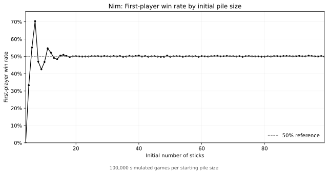
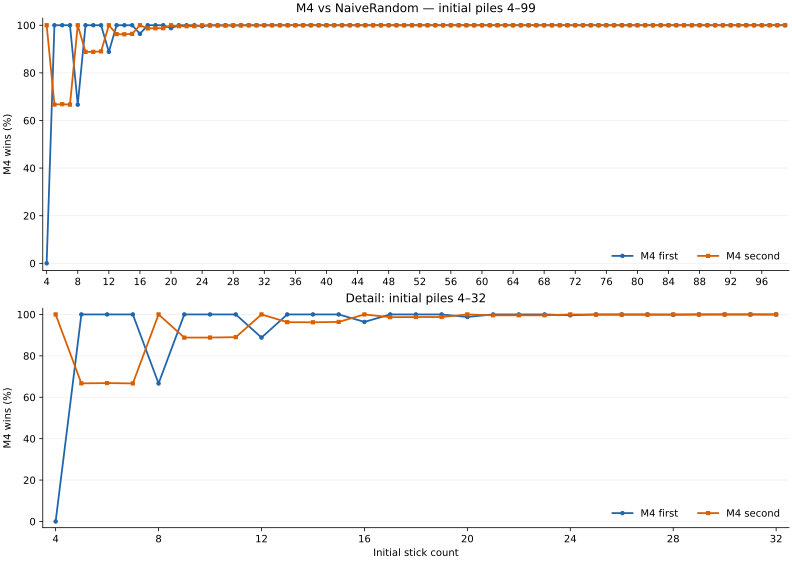

Nim is a rather simple game. A pile of sticks is placed between two players. The players take turns taking $1,$ $2,$ or $3$ sticks. The player to pick up the last stick wins. Other versions of the game exist involving multiple piles or playing such that the person to pick up the last stick loses.

Go play [**Nim in The Arcade!**](https://profhal.github.io/gamechancestrategy/nim.html)

You may have noticed we didn't say anything about the number of sticks in the initial pile. That can be any positive number. As we will see, the probability of winning depends on the initial number of sticks. Thus, we will examine and discuss results of agents playing games with piles varying between $4$ and $99$ sticks. 

The cases where the starting number of sticks is less than $4$ are well understood: Since all agents are endgame aware, if there are less than $4$ sticks, the first agent to play will take all the sticks and win.

## 1. Playing Naively
We begin with the simplest of agents: NaiveRandom. The agent plays by the following rule:

```
if 3 or fewer sticks remain
   take them all
else 
   randomly take 1, 2, or 3
```

For the first experiment, we let NaiveRandom play against itself. The results are shown in Figure 1. 

<figure class="numbered">
  
  <figcaption>
    Win rate for NaiveRandom against NaiveRandom as a function of the initial pile size.
  </figcaption>
</figure>

Already, we see the impact of the starting number of sticks.

## 2. A First Strategy
A natural next step a new player might attempt is simply taking a set number of sticks until the endgame. The agent that always takes $N$ sticks is called, NaiveConstant$N$. For example, NaiveConstant1 uses the following rule

```
if 3 or fewer sticks remain
   take them all
else 
   take 1
```

Figure 2 shows the probability of NaiveRandom, going first, winning against each of the NaiveConstant$N$s. 

<figure class="numbered">
  
  <figcaption>
    Win rate for NaiveRandom against NativeConstantN when going first based on 100,000 games per starting pile.
  </figcaption>
</figure>

Since seating order can affect the outcome of games, we also need to inspect the games where NaiveRandom goes second. Figure 3 shows the probability of NaiveRandom winning against NaiveConstant$N$ when going second.

<figure class="numbered">
  
  <figcaption>
    Win rate for NaiveRandom against NativeConstantN when going second based on 100,000 games per starting pile.
  </figcaption>
</figure>

Of course, we should also see how each NaiveConstant$N$ agent performs against itself and the other NaiveConstant$N$ agents. Figure 4 provides interactive graphs illustrating the match ups (hover over the labels to isolate graphs).

<figure id="fig-constant-strategies" class="numbered">
  <iframe
    src="{{ 'nim_constants_interactive.html' }}"
    width="100%"
    height="1460"
    style="border: none;"
    title="Nim Constant Strategy Comparisons">
  </iframe>

  <figcaption>
    First-player win probabilities for the three constant strategies against one another, for initial pile sizes
    4 through 99, based on 100,000 games per pile.
  </figcaption>
</figure>

## 3. Pile Residues
The next step involves considering the state of the pile that is left for the opponent. Since we are taking $1-3$ sticks, this will leave the piles in residues $\mod 4$. This brings us to our first Enthusiasts: EnthusiastResidue$N$ will make choices to leave the stick pile with residue $\mod 4$. Thus, we have EnthusiastResidue0 (eR0), EnthusiastResidue1 (eR1), EnthusiastsResidue2 (eR2), and EnthusiastResidue3 (eR3). When multiple moves are available, the choice is random.

<figure id="fig-constant-strategies" class="numbered">
  <iframe
    src="{{ 'nim_tournament_explorer.html' }}"
    width="100%"
    height="1650"
    style="border: none;"
    title="Exploring the Nim Strategy Tournament">
  </iframe>

  <figcaption>
    Interactive results from a tournament of eight Nim-playing agents over initial pile sizes of 4–99. Each cell in the heat map represents the first player's win percentage against the second player, with color indicating the degree of advantage or disadvantage. Select a cell to examine the results by initial pile size, or adjust the pile-size range to investigate how the relative performance of strategies changes. Diagonal cells are omitted because self-play results were not included in the tournament data.
  </figcaption>
</figure>

Clearly, something stands out: leaving your opponent a pile containing a multiple of $4$ sticks, residue $0$, is a strong strategy. If you are familiar with Nim, you likely knew that. But what we see here is that while it is an optimal strategy, it is not infallible. That is where things get interesting. Also, notice NaiveConstant1 performs reasonably well, too. Simplicity is not necessarily a weakness.

Before exploring that apparent contradiction, we should explain why leaving your opponent a multiple of $4$ sticks is optimal. Recall that a player may remove $1$, $2$, or $3$ sticks on each turn, and the player who takes the last stick wins. If you leave your opponent a multiple of $4$, they must remove $1$, $2$, or $3$ sticks. You can then remove $3$, $2$, or $1$ sticks, respectively, so that the two moves together remove exactly $4$ sticks. This returns your opponent to another multiple of $4$. By repeating this process, you eventually leave your opponent with $4$ sticks. Whatever they remove, you can take the remaining sticks and win. Of course, this strategy requires that you first have an opportunity to leave a multiple of $4$. If you begin with a multiple of $4$ yourself, a sufficiently clever opponent can use the same strategy against you.

## 4. Piles of Other Multiples
What we observed is leaving your opponent a pile that is a multiple of $4$ is advantageous. We will rename EnthusiastResidue0 to M4: attempt to leave the pile in a multiple of $4$. M4's decision structure is

```
if sticksRemaining % 4 == 0
  randomly take 1, 2, or 3
else
  take sticksRemaining % 4 sticks
```

Notice that M4 is endgame aware. 

What about leaving the piles in multiples of other numbers? Define M$n$ to be an agent that attempts to leave the pile in a multiple of $n$. M$n$'s decision is made in the following way

```
if 3 or fewer sticks remain
  take all the sticks
else 
  determine all moves that leave the pile in a multiple of n
  if the list is not empty
    choose a move randomly
  else
    randomly take 1, 2, or 3 sticks
```

We will consider two new agents: M2 and M3. We do not consider M$n$ for $n > 4$. The reason has to do with the number of sticks a player can remove. To leave an opponent a multiple of $n$, a player must remove a number of sticks equal to the current pile's remainder modulo $n$. Since the legal moves are $1$, $2$, and $3$, this is always possible for nonzero remainders when $n$ is at most $4$. But consider M5. If a pile contains $9$ sticks, we would need to remove $4$ sticks to leave a multiple of $5$, which the rules prohibit. More generally, for any $n > 4$, some nonzero remainders cannot be eliminated in a single move. Thus, M4 is the largest member of this family that can always reach its desired multiple from a pile that is not already a multiple of $n$.

Figure 6 shows the performance data for M2 and M3.

<figure id="fig-constant-strategies" class="numbered">
  <iframe
    src="{{ 'nim_tournament_explorer_with_M2_M3.html' }}"
    width="100%"
    height="1800"
    style="border: none;"
    title="Exploring the Nim Strategy Tournament">
  </iframe>

  <figcaption>
    Interactive results from a tournament of eight Nim-playing agents over initial pile sizes of 4–99. Each cell in the heat map represents the first player's win percentage against the second player, with color indicating the degree of advantage or disadvantage. Select a cell to examine the results by initial pile size, or adjust the pile-size range to investigate how the relative performance of strategies changes. Diagonal cells are omitted because self-play results were not included in the tournament data.
  </figcaption>
</figure>

M4 is still dominant with NaiveConstant1 and M2 exhibiting fairly strong performances.

## 5. The Weakness of M4
If you are familiar with Nim, you likely recognize M4 as being an optimal approach to playing. However, Figure 6 illustrates that it's not perfect. M4 can lose - and lose to much less sophisticated approaches. Figure 7 shows M4's performance against NaiveRandom over the varying piles in both playing positions. 

<figure class="numbered" class="numbered">
  
  <figcaption>
    Win rate for M4 against NativeRandom in both seat positions. The second graph provides a more detailed look at piles of 4 through 32.
  </figcaption>
</figure>

It's easy to explain. When $n$ is not a multiple of $4$ and M4 goes first, it controls the game as it's first move will leave a multiple of $4$ and it opponent won't be able to recover. So, for piles that aren't a multiple of $4$, M4 will always win when going first. When the pile is a multiple of $4$ and M4 goes first, it has to leave the pile in a non-multiple of $4$. NaiveRandom, on occasion, will make a series of decisions that always leave M4 a pile with a multiple of $4$ and win. As the number of sticks increases, the probability NaiveRandom will not leave the pile in a multiple of 4 increases and M4 will seize control. 

When M4 goes second, we see the opposite behavior. If the pile starts on a multiple of $4$, M4 will be able to seize control on its first move. For piles that are not a multiple of $4$, NaiveRandom has a chance to make the right series of moves and not concede control to M4. 

Note that while the graphs suggest M4 eventually always wins, that is not the case. It's just that the probability of M4 losing is very small. The probabilities displayed in the graph are the result of playing 100,000 games. However, we can directly compute the probability.

As an example, let's start with $4n$ sticks. In order for NaiveRandom to retain control, every two moves 4 sticks must be removed from the pile. This means the game will consist of each player taking $4n/4 = n$ turns. As NaiveRandom is endgame aware, it has to make the correct decision $n$-1 times. Each decision is randomly choosing $1$, $2$, or $3$ sticks with equal probability. That means, the probability NaiveRandom wins, or M4 loses, is

$$\text{P(NaiveRandom wins | 4n sticks)} = (\dfrac{1}{3})^{n-1}.$$

If $4n = 96$, then $n = 24$ and 

$$\text{P(NaiveRandom wins | 96 sticks)} = (\dfrac{1}{3})^{23} \approx 1.062208 \times 10^{-11}.$$


## 6. Understanding Other Strategies
The strength of M4 is well-understood. It's probability of losing is directly related to the probability its opponent makes all the right decisions. What can we say about the other agents. 

We will start by analyzing how each strategy performs against NaiveRandom. To start, Figure 8 shows how each agent performed against NaiveRandom over varying pile sizes.

<figure id="fig-constant-strategies" class="numbered">
  <iframe
    src="{{ 'nim_agent_curves_interactive.html' }}"
    width="100%"
    height="840"
    style="border: none;"
    title="Nim Agent Performance Against NaiveRandom">
  </iframe>

  <figcaption>
     The graph shows how each agent performed against NaiveRandom over varying pile sizes.
  </figcaption>
</figure>


### 6.1 The Secret Sauce
We call leaving the pile of sticks in a multiple of 4 the *Secret Sauce*. As that is the main element of M4's strategy, it's reasonable to think that regular application of the Secret Sauce might emerge in the behaviors of The other agents. That isn't necessarily the case. Figure 9 shows how frequently each agent applied a sauce move when one was available against NaiveRandom over varying pile sizes.

<figure id="fig-constant-strategies" class="numbered">
  <iframe
    src="{{ 'nim_sauce_all_agents_interactive.html' }}"
    width="100%"
    height="650"
    style="border: none;"
    title="Nim Sauce Adherence by Initial Pile Size">
  </iframe>

  <figcaption>
     The graph shows how frequently each agent makes the move prescribed by the optimal M4 strategy when playing against NaiveRandom.
  </figcaption>
</figure>

This suggests that their success against NaiveRandom cannot be explained simply by how closely they imitate M4 with respect to the Secret Sauce.

### 6.2 Slopping the Sauce
Maybe the question lies within how an agent concedes perfect play. An agent's failure to maintain winning positions depends on

- how frequently it encounters winning opportunities
- how often it fails to exploit them. 

We investigate these factors separately, examine their combined effect, and study how each contributes to changes in performance as the initial pile size increases.

Let $n$ be the number of sticks in the pile and define

- $O_{n}$ : the number of Secret Sauce opportunities
- $M_{n}$ : the number of Secret Sauce opportunities missed
- $G_{n}$ : the number of games played

We the define the following

- $o(n) = \dfrac{O_{n}}{G_{n}}$ : The average number of Secret Sauce opportunities per game
- $c(n) = \dfrac{M_{n}}{O_{n}}$ : The fraction of Secret Sauce opportunities missed
- $m(n) = \dfrac{M_{n}}{G_{n}}$ : The average number of missed sauce opportunities per game

and have the following relationship,

$$m(n) = c(n) \cdot o(n).$$

Observing Nim's winning and losing positions follow a $\text{mod } 4$ pattern, we can define a growth rate over a four stick interval to reduce the influence of Nim's periodic structure.:

$$g(n) = \dfrac{m(n + 4) - m(n)}{4}$$

Expressing $m(n)$ in terms of $c(n)$ and $o(n)$ yields

$$g(n) = \dfrac{c(n + 4)o(n + 4) - c(n)o(n)}{4}$$

which can further be rewritten as

$$g(n) = c(n + 4)\dfrac{o(n+4) - o(n)}{4} + o(n)\dfrac{c(n+4) - c(n)}{4},$$

which is the discrete version of the product rule.

Further, we can give names to the two terms in the growth function. Specifically, 

$$g(n) = g_o(n) + g_c(n)$$

where we define 

- opportunity-driven growth

$$g_o(n) = c(n + 4)\dfrac{o(n+4) - o(n)}{4}$$

- concession-driven growth

$$g_c(n) = o(n)\dfrac{c(n+4) - c(n)}{4}$$


Figure 10 provides an interactive display of these various functions over varying pile sizes. Table 1 describes each metric is telling us and what to look for in the graphs depicted in Figure 10.


<figure id="fig-constant-strategies" class="numbered">
  <iframe
    src="{{ 'nim_missed_sauce_rate_explorer.html' }}"
    width="100%"
    height="1200"
    style="border: none;"
    title="Nim Sauce Adherence by Initial Pile Size">
  </iframe>

  <figcaption>
     Explore how Nim agents encounter and miss winning opportunities as pile size increases. Six interactive graphs examine concession fractions, opportunities per game, missed opportunities per game, and their rates of change, including the opportunity-driven $g_o(n)$ and concession-driven $g_c(n)$ contributions to overall growth $g(n)$.
  </figcaption>
</figure>


| Metric | Question | What to look for in the graph |
|--------|----------|-------------------------------|
| $c(n)$  | When an agent has a winning opportunity, how often does it fail to exploit it? | A lower curve indicates an agent that more reliably preserves winning positions. A relatively flat curve suggests its concession fraction remains stable across pile sizes. A declining curve suggests it misses a smaller fraction of its opportunities as piles grow. |
| $o(n)$   | How many winning opportunities does an agent encounter during an average game? | An increasing curve indicates that larger piles create more opportunities for the agent to make a winning move. Differences between agents may reflect how their strategies and opponents influence the positions they encounter. |
| $m(n)$    | How many winning opportunities does an agent surrender during an average game? | Lower curves indicate fewer missed opportunities per game. An increasing curve may result from more opportunities, a higher concession fraction, or both. |
| $g(n)$    | How quickly does the average number of missed opportunities change as the initial pile grows? | A positive value means missed opportunities per game increase over the four-stick interval. A negative value means they decrease. A curve approaching a positive constant suggests approximately linear growth along a modulo-four subsequence. |
| $g_o(n)$ | How much of the change in missed opportunities comes from encountering more or fewer winning opportunities? | Positive values indicate that changes in opportunity frequency contribute to increasing missed opportunities. Larger values indicate a stronger contribution from this source. |
| $g_o(n)$ | How much of the change in missed opportunities comes from changes in the fraction of opportunities conceded? | Positive values indicate that the concession fraction is increasing and contributing to more missed opportunities. Negative values indicate that a declining concession fraction is offsetting some of the growth caused by additional opportunities. |

<p class="table-caption">The question each metric addresses and what to look for in the corresponding graphs.</p>

### We continue to dig. ***Stay tuned...***